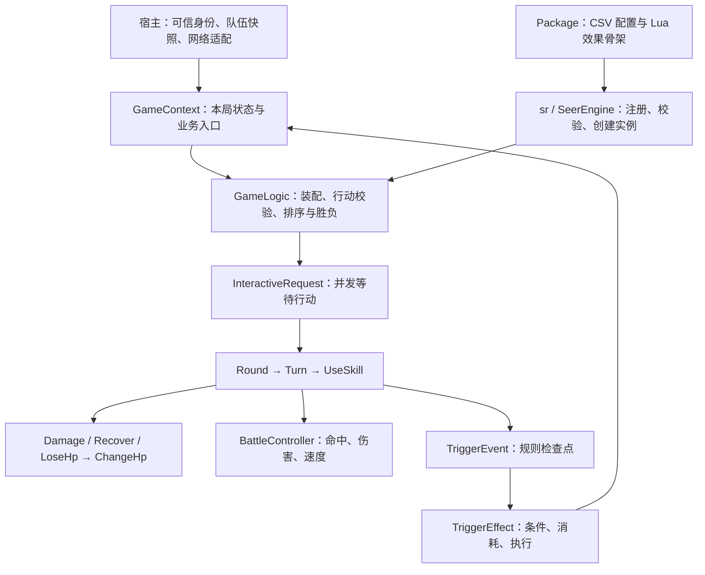

# seer-battle

赛尔号同人游戏的 Lua 回合制战斗组件。通用对象、协程和事件调度放在 `basescripts`，赛尔号战斗规则放在 `seer`，技能、Buff 和效果内容放在 `packages`。

当前已跑通本地终端单精灵对战：装配队伍 → 双方提交行动 → 按先制和速度排序 → 技能、伤害与回复 → 倒下与胜负结束。继续沿用现有 Context、Logic、GameEvent 和 TriggerEvent 分层，扩展规则通过效果骨架接入。

## 架构



| 层次 / 目录 | 职责 |
| --- | --- |
| `basescripts/core` | 通用 Engine、玩家、游戏实体、模式与触发时机 |
| `basescripts/corelib`、`basescripts/lib` | 协程调度、集合工具和随项目提供的 Lua 库 |
| `basescripts/gamethread` | 通用游戏线程、上下文、并发请求、完整事件与效果调度 |
| `basescripts/server` | 用户、房间、大厅与宿主适配；依赖宿主接口，尚未完成真实联网验收 |
| `seer/core` | Pet、Skill、Bag、Buff、能力等级、元素关系、Pattern、事件数据和内容引擎 |
| `seer/gamethread/game-context.lua` | 本局队伍快照、精灵查询和 `ctx:damage` 等业务入口 |
| `seer/gamethread/gamelogic.lua` | 分步初始化、装配队伍、校验行动、组织结算和判断胜负 |
| `seer/gamethread/battle_controller.lua` | 公式与随机默认行动；不直接改 HP、扣 PP 或派发事件 |
| `seer/gamethread/events` | 轮次、回合、技能、HP、Buff 与能力变化的完整结算 |
| `seer/gamethread/buff`、`seer/gamethread/statStage` | 状态与能力变化的管理接口 |
| `packages/standard` | 标准技能/Buff CSV、Lua 效果骨架和中英文文本 |
| `test` | 可运行的终端演示、示例队伍数据和启动脚本 |
| `tests` | 自动战斗流程与 Pattern 回归测试 |
| `docs` | 按模块维护的中文学习与接入说明 |

### 一局战斗如何运行

1. 初始化通用环境后，`require "seer.init"` 创建 `sr`，加载事件定义并安装标准包；宿主在 `kt.engine` 注册指定 Context 和 Logic 的 Boardgame。
2. GameThread 创建本局 Context。Logic 依次准备座位、读取 `battleData.players`、创建 Bag/Pet/Skill，再广播初始状态。
3. 每轮通过 `Seer.ChooseAction` 并发请求双方行动，收齐后统一排序。行动格式为 `{ type = "skill", skillId = 10031, targetId = 2 }` 或 `{ type = "pass" }`。
4. 选招时检查可用技能和目标；实际执行前复查技能归属、存活、出战状态、PP 和目标。超时、离线或非法回复从当前合法选项中随机选择，没有合法选项时跳过。
5. 按技能先制、精灵速度、座位顺序执行 Turn。UseSkill 扣一次 PP、检查命中并结算效果；先手击倒后手后，后手不再出招。
6. 伤害、回复和体力流失统一汇入 ChangeHp，更新 HP / alive、通知倒下并检查全队胜负；结束或异常退出时清理事件栈与临时效果作用域。

`GameEvent` 表示一段完整结算，例如使用技能或造成伤害；`TriggerEvent` 是结算中的检查点，例如命中后、伤害前。`TriggerEffect` 在检查点执行条件、消耗与效果，特殊技能可以调用 Context 入口嵌套结算。

每局随机源保存在 Context，命中、默认选招和随机能力变化复用它。相同种子、初始快照、配置与行动序列可以复现这些结果；同速目前按座位排序。

### 静态配置与局内状态

```text
技能 / Buff CSV + Lua EffectSkeleton
  → Package 加载与校验 → Engine 按固定 ID 建立索引
  → createSkill / createBuff → 本局独立 Skill / Buff / TriggerEffect
  → Logic 在 TriggerEvent 检查点调度实际效果
```

- CSV 保存普通配置表；技能 `maxPp` 是配置，当前 `pp` 属于局内 Skill。
- 引擎共享 EffectSkeleton，实际 Effect 及其 `can_triggervalue`、`on_usevalue` 参数分别复制。不同精灵、不同战斗的效果实例相互隔离；同一技能多次使用时复用自己的实例。
- Buff 的类别来自配置，持续轮数、次数、层数等由本次施加的 `state` 提供。能力等级单独保存在 `Pet.statStages`。
- 内容使用显式固定 ID，调整 CSV 行或效果文件顺序不会改变编号。翻译保存 key，显示时通过 `sr:translate` 选择语言。

### 宿主与数据边界

宿主提供可信玩家身份、队伍快照、随机种子及 `kt.c` 网络接口；客户端只提交操作意图，不能决定伤害、面板或存档。连接编号不能当作数据库账号编号。

当前终端和回归测试使用宿主输入输出适配器，没有真实客户端连接，也没有数据库表、迁移或存档读写。后续与同目录 `seer-asio` / `Re-Seer` 集成时，由服务端认证会话确定身份、校验并持久化 PostgreSQL 存档；终端与 Unity 客户端共用业务协议。这些属于接入规划，尚未实现。

## 运行与验证

战斗流程需要 **Lua 5.5**，现有协程库使用其语法。请先安装运行时；仓库不包含本机 Lua 可执行文件。在项目根目录运行：

```powershell
# 交互演示，默认控制雷伊
.\test\run-seer.ps1 -Lua '你的 Lua 5.5 可执行文件路径'

# 双方自动；若 lua55 已加入 PATH，可省略 -Lua
.\test\run-seer.ps1 -Auto

# 自动回归
lua55 tests/battle_flow.lua
lua55 tests/pattern.lua
lua55 tests/damage_formula.lua

# 也可以直接启动演示
lua55 test/seer_battle.lua --auto
```

双人键盘模式使用 `-Pvp`。详细输入方式与示例技能见 [终端演示说明](test/README.md)。终端输入为阻塞读取；真实网络的请求计时、回调与过期回复隔离仍需宿主联调。

历史验证记录（以下不是每次文档修改后的重新执行结果）：

| 日期 | 检查 | 当时结果 |
| --- | --- | --- |
| 2026-10-21 | `tests/battle_flow.lua` | 64 组通过，覆盖流程、请求并发与取消、状态事件、配置校验、效果隔离及参数化技能 |
| 2026-10-21 | `tests/pattern.lua` | 6 组通过，覆盖能力/元素筛选、边界与非法输入；该项也支持 Lua 5.3 |
| 2026-10-21 | 终端自动对战 | 雷伊第 3 轮获胜，双方剩余 HP 118 / 0，事件栈清理完成 |
| 2026-10-31 | 行动扩展回归 | 仓库原有记录：68 组战斗流程、6 组 Pattern 通过 |
| 2026-10-31 | 伤害数据分层局部验证 | 5 个选定伤害检查通过（含新增 2 个用例）；Lua 5.4 同步调度替身，未运行全面回归 |
| 2026-10-31 | Buff / 消强 / 独立计算修复 | 临时编译的真实 Lua 5.5.0 下 25 个相关用例通过；未运行全面项目测试 |
| 2026-10-31 | 普通伤害公式扩展 | Lua 5.5.0：10 个公式用例、13 个相关战斗回归通过；676 项单属性数据对照无差异；未运行全面项目测试 |
| 2026-10-31 | 首批经典异常 | Lua 5.5.0：12 个相关流程、10 个公式用例通过；官方公开配置核对基础效果；未运行全面项目测试 |
| 2026-10-31 | 分类配置与雷神魂印 | Lua 5.5.0：22 个相关流程用例通过，覆盖新增异常、装配、实际出手顺序、概率边界及换宠；未运行全面项目测试 |
| 2026-10-31 | 通用异常施加入口 | Lua 5.5.0：9 个相关用例通过，覆盖默认随机 2～3 轮、显式覆盖、概率、免疫、参数校验和雷神复用；未运行全面项目测试 |

## 已实现与待完善

已实现普通物理/特殊红伤（含本系、克制、浮动、暴击及暴击抗性）、命中、独立 PP、回复和固定伤害、能力等级变化、Buff 添加/移除及异常事件、统一生命周期与玩家方印记、独立元素伤害计算、CSV 内容装配和翻译。已按官方公开配置接入中毒、烧伤、冻伤、疲惫、麻痹、害怕、睡眠的基础效果，证据和边界见[首批经典异常](docs/classic-abnormal-statuses.md)。支持多精灵背包装配与查询，携带队伍与当前出战精灵分开；通常六只的队伍限制尚由宿主约束。

以下尚未实现：

- 手选倒下补位、技能自用及多目标选择；当前支持主动换宠、自动补位、局内回血与 PP 道具，详见行动协议。
- 连击、变威力等特殊计算与完整装备/魂印修正；普通红伤已接入本系、元素克制、整数浮动、暴击和暴击抗性，尚未完成官方全量差分验证。
- 原版异常重复施加/共存规则、全量魂印及精灵身份映射和第五技能统一接入。已实现 Buff 轮末计时、过期清理、下场策略、玩家方状态和常规驱散限制。
- 正式精灵数据、由性格/个体值计算面板、真实联网、账号与存档持久化、Unity 界面。
- 同速公平规则、完整回放、并发及长战斗性能验收。

## 新增行动验收（2026-10-31）

支持 switch / item 玩家行动、独立换宠与道具事件、比例固定伤害骨架；历史测试数量集中见上表。具体修改与限制见 [行动协议与移植说明](docs/action-protocol.md)。

## 模块文档

- [战斗流程与事件](docs/battle-flow.md)
- [行动请求、宿主接口与战斗计算](docs/requests-and-battle-controller.md)
- [静态配置、引擎与扩展包](docs/seer-engine.md)
- [效果骨架与两组参数表](docs/effects.md)
- [背包与精灵装配](docs/bag.md)
- [Buff 基础结构](docs/buffs.md) · [Buff、异常与能力变化流程](docs/state-flows.md)
- [精灵面板与能力等级](docs/stats.md) · [普通伤害公式与实测边界](docs/damage-formula.md)
- [属性与克制](docs/elements.md) · [能力/元素筛选 Pattern](docs/patterns.md)
- [描述翻译](docs/i18n.md)
- [当前架构审阅快照](docs/project-review-2026-10-31.md) · [生命周期与独立伤害计算](docs/lifecycle-and-damage-design.md)

README 集中维护项目架构、带日期的历史验证记录和未实现项；模块文档解释具体接口和取舍，避免重复维护阶段性进度。

## 仓库内容与来源

保留可复跑的终端演示和回归测试。临时试验放在 `test/local`、`tests/local` 或 `scratch` 子目录，亦可使用 `*.local.lua` / `*.scratch.lua`；这些文件以及编辑器配置、日志、构建产物、本机运行时和本地凭据由 `.gitignore` 排除。

通用基础设施参考并适配 `ktabletop`，事件设计参考新月杀；保留源文件中的作者和 SPDX 许可标记。多数业务文件标记为 LGPL-2.1-or-later，`seer/core/events/hp.lua` 标记为 GPL-3.0-or-later；内置第三方 Lua 库保留各自许可声明，不能将所有文件统一视为同一种许可。

异常、印记、魂印分表及雷神的配置入口见[分类内容架构](docs/content-and-soulmarks.md)。
