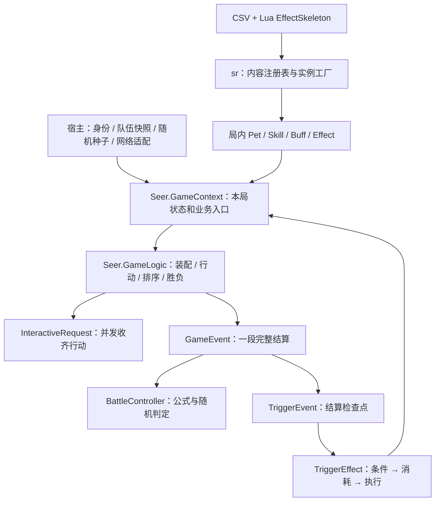

# 项目架构与规则审阅（2026-10-31）

审阅基线：`0a1478d`。本次只新增审阅文档，没有修改业务代码。结论来自源码、现有测试阅读和局部规则验证；仓库原有的 68 组流程测试通过记录不是本次执行结果。

后续文档维护：同日已修订 R8 所列过时说明及 BuffType=4 的名称，将测试数量集中到 README 的历史记录。本文件保留原审阅时的文档问题作为快照。同日后续已修复 R1/R2/R3/R5，新增 side 状态、统一计时和独立元素计算；本文件保留最初审阅快照，不作为当前未实现清单。最新规则见 [实施说明](lifecycle-and-damage-design.md)，验证见 README。

## 1. 项目目前处于什么阶段

这是 Lua 战斗组件，当前可独立演示一场精灵对战；尚不是包含地图探索、捕捉、养成、存档和客户端的完整游戏。

已形成的主干是：可信队伍快照 → 局内对象 → 并发选择行动 → 排序 → 行动与技能事件 → 效果触发 → HP / 能力 / Buff 变化 → 胜负。

架构分层值得保留。主要风险是规则尚未补齐、部分接口只有结构没有业务、文档与实现进度不一致。现阶段应先收敛战斗规则，避免继续增加内容后把示例行为固化成默认规则。

| 子系统 | 当前状态 | 审阅判断 |
| --- | --- | --- |
| 本地战斗流程 | 双方收齐行动、排序、技能、HP、胜负、轮次上限 | 主干已实现；本次未执行完整对战 |
| 行动 | skill / pass / switch / item，自动倒下补位 | 已实现基础版本，缺手选补位和更完整限制 |
| 普通伤害 | 物理 / 特殊、攻防比、能力等级 | 简化公式，未接属性克制、本系、暴击、连击等 |
| 能力等级 | 六项、±6、倍率、强化弱化消强、事件 | 较完整；消强存在嵌套结算缺陷 |
| 异常状态 | 异常施加管道 + 示例中毒 | 有框架，不能视为完整原版异常系统 |
| Buff | 独立实例、轮数/次数/层数、施加移除 | 数据结构完整于通用生命周期 |
| 内容 | 标包 4 个技能配置、2 个 Buff 配置、多种效果骨架 | 属于演示内容；终端另注册示例技能 |
| 元素 | 单双属性关系模块、筛选 Pattern | 有查询算法，尚未进入伤害结算 |
| 被动 / 第五技能 | 部分字段和入口 | 尚未完整装配与执行 |
| 服务器 / 存档 / 客户端 | 房间等宿主适配代码与接口约定 | 未完成真实网络验收，无持久化闭环 |

## 2. 目录与职责

```text
seer-battle/
├── basescripts/                    通用底座：不应放赛尔号专属规则
│   ├── core/                       Engine、Boardgame、GameUnit、TriggerEvent
│   ├── corelib/                    async、集合、基础工具
│   ├── lib/                        middleclass、JSON、随机数、调试等库
│   ├── gamethread/                 通用 Context / Logic / GameEvent / 请求
│   └── server/                     Server、Room、Lobby、User 与宿主接口
├── seer/
│   ├── init.lua                    建 sr → 定义时机 → 安装标准包
│   ├── core/                       规则对象与配置，不承担完整结算流程
│   │   ├── pet.lua / bag.lua        精灵、携带队伍、道具库存
│   │   ├── stat.lua                原始面板与 HP
│   │   ├── stat-stages.lua         六项能力等级及倍率
│   │   ├── skill.lua / buff.lua    局内技能、状态实例
│   │   ├── events/                 事件数据类、触发时机定义
│   │   ├── effect_type/            触发效果实例与骨架
│   │   ├── engine.lua / package.lua 内容注册、校验、实例化
│   │   ├── csv_util/               CSV 与效果引用解析
│   │   ├── element.lua             属性克制查询
│   │   └── pattern/                能力、元素筛选
│   └── gamethread/                 赛尔号实际战斗规则
│       ├── game-context.lua        本局对象查询与业务门面
│       ├── gamelogic.lua           装配、选行动、排序、效果收集、胜负
│       ├── battle_controller.lua   伤害、命中、速度、默认选招计算
│       ├── action_manager.lua      换宠、道具的合法性与入口
│       ├── buff/buff_manager.lua   Buff 查询与施加/移除入口
│       ├── statStage/              能力变化入口
│       └── events/                 Round、Turn、UseSkill、HP、Buff 等结算
├── packages/standard/
│   ├── skills/standard_skill.csv   技能静态配置
│   ├── buffs/standard_buff.csv     Buff 静态配置
│   ├── effects/                    Lua 效果骨架
│   ├── items.lua                   当前固定道具表
│   └── i18n/                       中英文文本
├── test/                           终端演示、演示队伍、PowerShell 启动器
├── tests/                          battle_flow.lua、pattern.lua 自动回归
└── docs/                           按模块说明和协议
```

审阅时不必逐行通读 `basescripts/lib`。先看赛尔号主流程，再按调用关系下钻到底座。

## 3. 核心架构与状态所有权



- `kt.engine` 注册可运行的游戏模式，`sr` 管赛尔号技能、Buff、效果等内容。两者层次不同。
- `GameContext` 是一局的状态与门面；`GameLogic` 组织规则；`GameEvent` 处理完整动作；`TriggerEvent` 给效果提供插入位置。
- `BattleController` 只计算，不扣 PP、不改 HP、不派发事件。这条边界应保留。
- Player 拥有 Bag；Bag 拥有携带 Pet；`player.pet` 指向当前出战者；`ctx.pets` 列出本局所有精灵。
- `pet.stat` 保存原始面板和 HP；`pet.statStages` 保存能力等级；读取战斗能力时计算倍率，不回写面板。
- CSV 与 EffectSkeleton 是共享定义；Skill 的 PP、Buff 的计数、实际 Effect 的参数是局内状态。引擎创建的实例做了隔离。
- `Pet.fifth_skill` 虽有字段，但装配直接沿用输入，且普通选招/效果收集未完整纳入它，不能视为可用第五技能。

扩展原则：普通技能规则优先使用效果骨架；新结算类型用 GameEvent；公式修改集中在 Controller；避免每增加一个技能就向主 Logic 塞特判。

## 4. 从开始到结束的实际流程

### 启动

终端入口是 `test/seer_battle.lua`：准备 kt 的类库/JSON/随机数/宿主替身 → `require seer.init` → 注册 Boardgame → GameThread 创建指定 Context → Logic 启动根 GameEvent。

宿主路径由 `basescripts/server` 转交房间用户、gameType、battleData。它依赖宿主的 ktabletop / kt.c，不能只看这些文件存在就认定真实服务器已经联通。

`SeerGameLogic:run()`：

1. `prepareRoom`：准备座位。目前断言至少两人，没有限定恰好两人。
2. `loadRoleData`：按玩家读取 battleData → Bag → Pet → 独立 Skill / PP。
3. `prepareForStart`：广播 BattleReady，触发 GameStart。
4. `action`：胜负检查 → 创建一轮 → 结算 → 继续，超过 maxRounds 则结束。

### 每一轮

```text
RoundStart 广播和触发
  → 自动给已倒下的出战精灵补位（背包第一只存活者）
  → BeforeActionChoice
  → 并发请求双方 Seer.ChooseAction
  → 收齐回复、验证、必要时随机托管
  → AfterActionChoice
  → 一次性排序
      换宠/道具优先于技能
      技能先制 → 有效速度 → 座位
  → 第一方 Turn：BeforeTurnStart → TurnStart → 行动 → TurnEnd
  → 检查全队胜负
  → 第二方 Turn（出战者已倒下则不行动）
  → 检查全队胜负
  → RoundEnd：包含示例中毒结算
  → 检查全队胜负
```

Round 是双方行动组成的一轮；Turn 是其中一方的一次行动。以后状态持续时间应明确按哪个计数，避免“回合”二字混用。

行动请求支持 skill / pass / switch / item。非法、离线、超时回复的兜底目前只随机选合法技能/目标；即使有换宠或道具选项，没有技能也会兜底 pass。明确 pass 不随机。真实计时、过期回复隔离仍由宿主承担。

技能在执行前复查当前出战者、技能归属、存活、PP、目标。对方主动换宠后，原先瞄准它的攻击改打新上场精灵。

倒下补位发生在下一轮的 RoundStart 触发之后，当前轮剩余阶段和下一轮 RoundStart 都可能仍看到倒下者。当前内置内容不一定暴露问题，但要在增加入场魂印、回合开始回血等内容前确定补位语义。

### 技能与 HP

```text
BeforeSkillUse
  → 扣一次 PP，广播 SkillUsing
  → SkillUsing
  → BeforeSkillHit
  → 命中随机 / 显式 hit 覆盖
  → 未命中：SkillMissed
  → 命中：SkillHit（强化、回血、中毒等效果可在这里执行）
      → 攻击技能基础伤害计算
      → BeforeSkillDamage
      → Damage
      → AfterSkillDamage
      → SkillEffectFinished
  → SkillUseFinished
```

实际还存在中断分支，上图表示正常路径。属性技也需要一个合法敌方目标才能走公共 UseSkill，但效果内部可作用于自己；尚无统一的自用/敌方/全体目标模型。

Damage 经多段伤害检查点汇入 ChangeHp；Recover 和 LoseHp 也汇入 ChangeHp，但不经过伤害检查点。后者适合承载异常扣血，避免误触普通护盾或受击效果。ChangeHp 更新 HP / alive，广播并发出 PetFainted；全队胜负主要由外层 Round / action 检查，并非每次 HP 变化立即结束战斗。

## 5. 异常状态系统：框架有了，规则内容很少

### 已完成

- Buff 实例支持 turn、count、stacks、maxStacks、value、dispellable；任一计数归零可视为过期。
- 异常属于 BuffType.Abnormal，能力升降另放 StatStages，没有混入异常类别。
- addBuff 遇到异常会自动转入 ApplyAbnormal，不能直接绕过异常检查点。
- 流程为 PreAbnormal → AbnormalCaused → AbnormalInflicted → AddBuff → AbnormalApplied → AbnormalFinished。
- 有前置阻止、精确实例移除、嵌套添加防重复、共享定义与局内实例隔离等保护。
- 标包仅有中毒和护盾两个 Buff；其中中毒才是异常。中毒默认技能施加 3 轮，每轮 RoundEnd 经 LoseHp 扣最大 HP 的 1/8，向下取整且至少 1。

### 还没有形成的规则

- 麻痹、害怕、疲惫、睡眠、烧伤、冻伤、寄生等没有标准行为实现。
- 只有可供免疫效果接入的时机；没有通用异常抗性概率、元素免疫、反弹异常或穿透免疫体系。
- 没有明确的异常共存、重复施加刷新、叠加、互斥政策。
- turn 不会自动走；中毒骨架自己推进轮数，护盾骨架自己扣次数。新内容漏写就可能永久有效。
- dispellable 目前是数据字段，没有独立驱散策略。不能简单把 removeBuff 全面禁止用于不可驱散 Buff，因为自然到期、换宠移除与驱散应有不同语义。
- 状态进度变化没有统一更新通知；客户端难以仅凭现有 BuffAdded / BuffRemoved 同步剩余轮数。

### 与原版对照的证据边界

仓库没有指定复刻的年代、页游版本或 PVE/PVP 规则集。以下使用仓库已引用的民间机制整理，不能宣称官方认证或完整复刻。不同资料对异常扣血时点的描述也存在差异，应以目标版本录像或实测固定。

- [PVE 百科全书](https://jiangshibiao.github.io/Summary-of-Game-Mechanism-in-Seer/index.html)列出中毒叠加、睡眠受击解除、烧伤影响攻击伤害、控制异常限制出招等机制。当前只实现了简化中毒。
- [异常状态机制整理](https://www.newton.com.tw/wiki/%E7%95%B0%E5%B8%B8%E7%8B%80%E6%85%8B/61814498)描述了重复中毒与更细的出手流程扣血时点，与当前单一 RoundEnd 存在待核对差异。
- 换宠后的异常处理缺少明确策略。搜索中“切换清除所有异常”的直接表述来自[手游 Wiki](https://wiki.biligame.com/seerm/%E5%BC%82%E5%B8%B8%E7%8A%B6%E6%80%81)，不能用它直接证明页游规则；本次将“中毒保留且停表”记为已复现行为，将是否应该清除、哪些例外保留为目标页游版本待核对项。页游与手游资料必须分开。

控制状态建议在技能执行前校验，而不是全部用 BeforeActionChoice 阻止整次行动：普通控场与禁止换宠的状态需要区分，不能连道具和换宠一起误封。对手先手施加控制时，后手已经提交的技能也要被阻止。

## 6. 能力等级系统：主体方向正确

`StatStages` 提供攻击、防御、特攻、特防、速度、命中六项，统一限制 -6～+6；不引入 HP 等级或宝可梦式独立闪避等级。

前五项强化倍率为 `(2+n)/2`；弱化 n 级为 `2/(2+n)`。例如 +1 为 1.5 倍、+6 为 4 倍、-6 为 0.25 倍。命中正等级沿用强化倍率，负等级使用 85%、70%、55%、45%、35%、25% 查表。这与[项目参考的机制整理](https://jiangshibiao.github.io/Summary-of-Game-Mechanism-in-Seer/index.html)一致，但整体命中系统还缺必中、闪避、装备等修正。

已正确完成的工程细节：

- 面板与等级分离，避免多次读取能力导致累乘。
- 批量参数先验证再修改，精灵间状态独立。
- 伤害、速度、命中实际使用能力等级，非仅保存字段。
- changeStages / strengthen / weaken / clearBoosts 共用 ChangeStages 事件。
- 有前置防止、真实变化量、前后快照、变更广播和无变化结束事件。
- 当前换宠已直接 reset 离场者等级；旧 stats 文档中“未实现换宠清除”已经过时。

未完成：能力反转、偷取/转移、清除负等级，以及这些操作与免疫、嵌套时机的组合。建议先修好消强提交语义，再增加此类操作。

## 7. 优先 review 的具体问题

### R1：消强把旧等级提前转换成变化量，嵌套前置效果后可能残留强化或变成弱化

位置：`seer/gamethread/statStage/statstage_manager.lua:44`，`seer/gamethread/events/stage.lua:18`。

clearBoosts 在触发 BeforeStageChange 之前读取等级并生成负 delta。ChangeStages 虽在前置效果之后重新拍快照，却没有重新计算消强量。

本次局部复现：

```text
攻击 +2 → 请求消强（生成 -2）→ 前置强化到 +3 → 提交后 +1
攻击 +3 → 请求消强（生成 -3）→ 前置降到 +1 → 提交后 -2
```

建议：把“清除所选正等级”的意图保留到实际提交点解析，明确前置时机可修改哪一层数据；不要靠重复执行消强补丁修正。验收覆盖前置增减、前置转负、免疫和选择部分能力。

### R2：换宠保留异常，后备状态停表

位置：`seer/gamethread/events/action.lua:18`，`seer/gamethread/gamelogic.lua:291`。

SwitchPet 仅 reset 能力等级，不移除 Buff。效果收集只遍历当前出战者，因此中毒者换下后既不扣血也不减轮数，换回又继续。

本次局部复现换宠后原精灵中毒仍在且 turn 不变。建议给 Buff 定义离场策略，至少区分异常清除、战斗内持续、随来源/场地存在等情况；不要一刀切删除魂印等所有 Buff。等级清零也应有清晰的客户端同步约定，目前换宠广播没有附带清零后的等级。

### R3：过期但未移除的 Buff 会卡住重新施加

位置：`seer/gamethread/events/buff.lua:21`，`seer/core/buff.lua:isExpired`。

效果收集排除过期 Buff，但 AddBuff 用包含过期对象的 getBuff 检查重复。没有统一清理时，或自然过期移除被 BeforeBuffRemoved 阻止时，会形成不可生效又不能重施加的状态。

本次局部复现：列表里留有 turn=0 的中毒，新 turn=3 中毒添加失败。建议统一过期清理、重复策略和移除原因，保证自然到期不会留下永久占位。

### R4：中毒不能刷新/叠加，是显式示例规则

位置：`packages/standard/effects/poison.lua:10`，`tests/battle_flow.lua:617`。

施加条件排除已有中毒，AddBuff 也拒绝同编号重复；现有测试明确断言不叠加不刷新。这证明实现稳定遵循了示例规则，不能证明符合原版。先固定目标版本重复中毒规则，再调整内容和测试。

### R5：出场切换时的效果收集与离场后时机不匹配

位置：`seer/gamethread/events/action.lua:19`，`seer/gamethread/gamelogic.lua:291`。

先把 player.pet 切为新宠，再触发 AfterPetLeave。此时 collectEffects 已不包含旧宠的 pet.effects / buffs；因此挂在旧宠上的离场后监听不会通过自动收集执行。新宠效果反而已经进入收集，早于 BeforePetEnter。

这是静态调用链确认的生命周期风险，本次未做完整调度集成复现。建议明确每个出入场阶段哪些效果有效，可采用阶段性的效果集合或明确来源分派，不要仅靠当前 player.pet 隐含决定。

### R6：通用规则层直接依赖标准包道具

位置：`seer/gamethread/action_manager.lua:3`。

技能和 Buff 已经经由 sr 注册，道具却直接 require packages.standard.items。长期会让其他包难以新增或覆盖道具。建议下一次扩展道具时统一为内容注册与实例/库存查询，不必现在重做整套插件系统。

### R7：队伍装配边界缺少统一校验

位置：`seer/gamethread/gamelogic.lua:77`，`seer/core/bag.lua:initialize`。

“最多六只”目前是注释与测试样例，不是强制限制。精灵单位 ID 的全局唯一性、activePetId 存在性、HP 不超过上限、道具数量等也缺统一导入校验。activePetId 错误会留下 nil 出战者，后续补位等路径访问它时会报错。

来源虽然是可信宿主，仍可能发生存档/迁移/配置错误。建议在创建局内对象前一次性校验，并提供带玩家、精灵 ID 的错误信息。

### R8：已有文档与代码不同步

- battle-flow 文档仍写换宠/道具未实现，实际已有独立事件。
- stats 文档仍写换宠不清能力等级，实际已清。
- test README 与各模块文档保留多组历史测试数量，容易被误读成当前验收。
- Package 的道具接入注释与实际 action_manager 的直接标准包依赖不是同一层面的完成状态。

建议将阶段进度集中维护在 README，模块文档只写当前接口与规则，并注明示例行为和原版兼容状态。

## 8. 架构取舍与建议顺序

不用为了获得掌控感推倒现有 Context / Logic / Event / Effect 分层，也不用先机械拆小所有文件。优先做下面几件事：

1. 写一张目标规则表：版本、模式、状态叠加、持续时间、换宠、补位、同速与必中语义。每条附证据或标记“自定义”。
2. 修 R1 / R2 / R3，明确状态生效、计时、到期、移除、出入场的统一生命周期；补充最小用例。
3. 先增加少量有代表性的异常：麻痹验证后手出招限制，睡眠验证受击解除，烧伤验证扣血与攻击修正，寄生验证来源和回复。
4. 接通属性克制、本系等基础伤害修正，再做更复杂技能；处理普通伤害、固定伤害、百分比、HP 流失的适用边界。
5. 收敛规则输入校验、状态同步、道具注册。保留 ctx 为统一业务入口，少用直接写 pet.stat / statStages / buffs 的脚本。
6. 在这些规则稳定后，再完善被动、第五技能、手选补位、真实网络和持久化。

触发时机多本身不是问题，但要为每个时机规定：触发对象、可改字段、返回 true 的含义、取消后是否扣 PP/道具、是否发 Finished。GameEvent 的清理保证栈和作用域恢复，不等于对已提交 HP / PP / 库存做事务回滚。allGameEvents / eventRecorder 也会保留历史对象，不等于可持久化完整回放。

## 9. 建议阅读顺序与最小验收

第一遍只看骨架：

1. `test/seer_battle.lua` + `test/seer_data.lua`：实际怎么启动、输入是什么。
2. `seer/gamethread/gamelogic.lua`：一局怎么装配、选行动、排序、判胜负。
3. `seer/gamethread/events/gameflow.lua`：Round / Turn 的边界。
4. `seer/gamethread/events/skill.lua` + `events/hp.lua`：技能和数值如何真正落地。
5. `seer/gamethread/battle_controller.lua`：公式有哪些、缺什么。

第二遍追一个技能：CSV → Package → Engine.createSkill → 实际 Effect → SkillHit → ctx 业务入口 → 结算事件。

第三遍看状态：stat-stages → stage manager / event；buff → buff manager / event → poison / poison_tick → 换宠。

最后再审通用底座：`basescripts/gamethread/gamelogic.lua` 的 dispatchTrigger / trigger，`gameevent.lua` 的 exec / clear / shutdown，`interactive-request.lua` 的并发请求；无需一开始通读全部 async 实现。

建议的最小回归场景：

- 先手控制让后手技能失败，明确 PP 是否扣除；普通控制下换宠和用药是否允许。
- 中毒先手/后手施加、重复施加、轮数耗尽、换下再换回。
- 过期移除遇到前置阻止后能否重施加。
- 消强前置嵌套强化/弱化/转负，结果不应产生意外弱化。
- 换宠前后旧宠/新宠效果的收集范围，以及客户端状态清零同步。
- 倒下后补位与 RoundStart / RoundEnd 的顺序。
- 同速规则、无 PP 兜底、非法 activePetId / 重复单位 ID 的导入失败。

## 10. 本次验证记录

- 本机 `lua -v` 为 Lua 5.4.8；未发现 lua55 命令。
- 对 async.lua 做语法检查，在 303 行遇到 Lua 5.5 的具名可变参数语法；本机 5.4 不能直接执行现有完整战斗回归。
- 没有运行全面项目测试，也没有把历史测试通过数当作本次结果。
- 在 `/tmp/seer-review-smoke.lua` 做局部验证：加载实际引擎、StatStages、Buff；仅将 GameEvent 协程外壳替换为同步测试壳，调用真实 stage / buff / switch 事件 main 方法。它不验证异步调度、完整效果收集或真实网络。
- 已通过：能力上下限、实例隔离、倍率表、批量非法参数原子性、显式轮数到期。
- 已复现：消强残留强化、消强产生弱化、过期 Buff 阻止重施加、换宠保留中毒。
- 原版差异基于公开民间资料和代码比较；异常时点、叠加细节和版本差异仍需目标版本实测。
